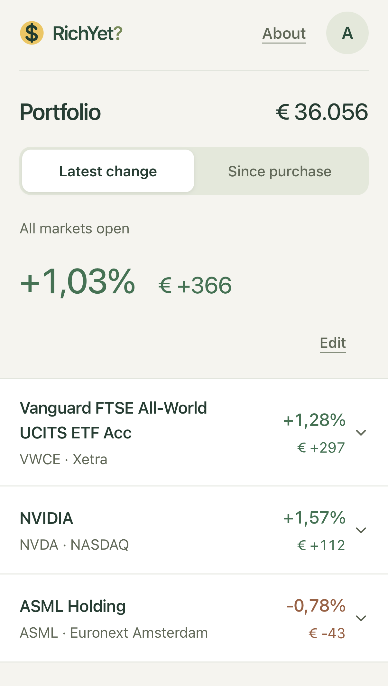
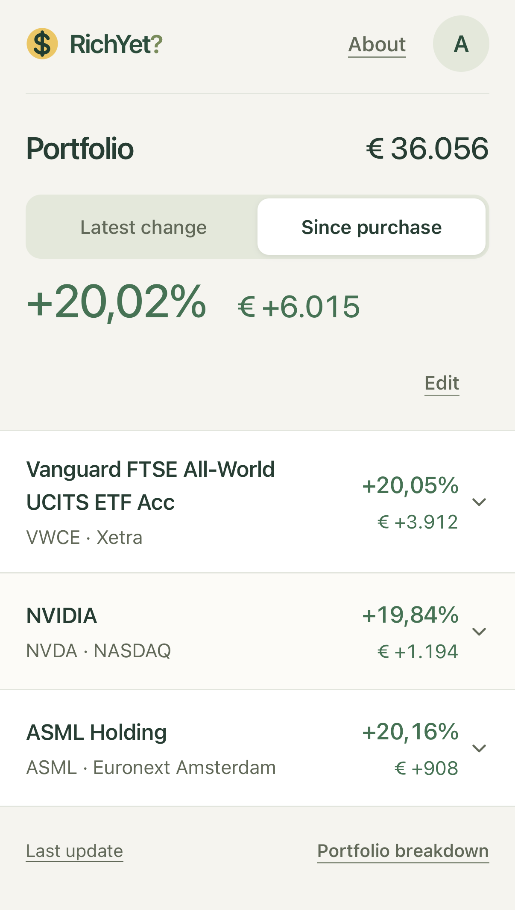
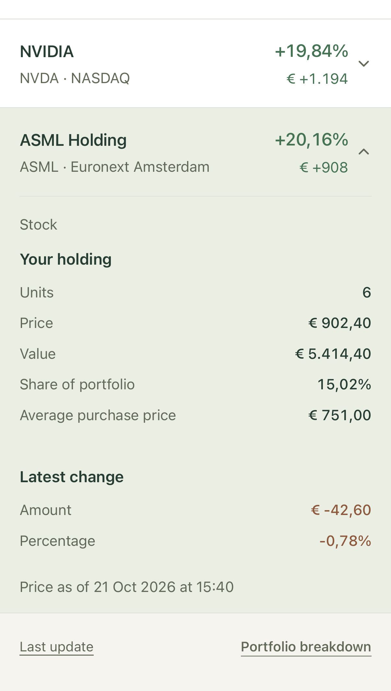
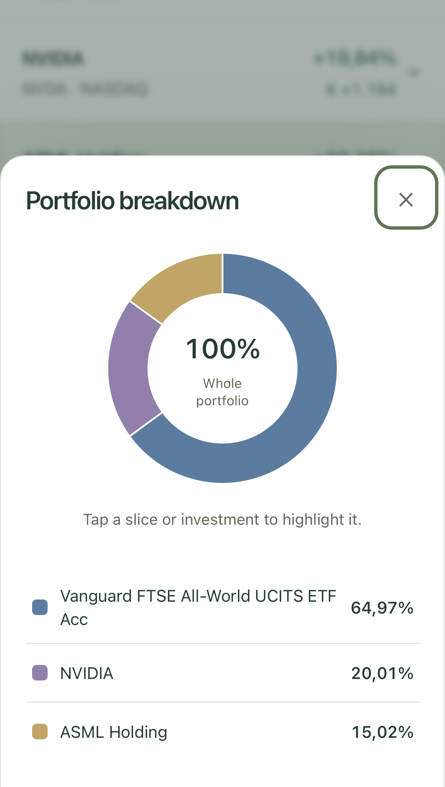

# RichYet?

A simple personal investment overview for your phone or computer. See your portfolio value, its latest movement and gain or loss since purchase, then expand a holding for details.

This is the main development repository for the **personal self-hosted RichYet app**. The [source code](https://github.com/msmeehui/richyet-self-hosted) is MIT-licensed; provider data and access are separate.

## Screenshots

Click an image to view it at full size.

<table>
  <tr>
    <th>Latest change</th>
    <th>Since purchase</th>
  </tr>
  <tr>
    <td><a href="screenshots/latest-change.png"></a></td>
    <td><a href="screenshots/since-purchase.png"></a></td>
  </tr>
  <tr>
    <th>Expanded holding</th>
    <th>Portfolio breakdown</th>
  </tr>
  <tr>
    <td><a href="screenshots/expanded-holding.png"></a></td>
    <td><a href="screenshots/portfolio-breakdown.png"></a></td>
  </tr>
</table>

*Example portfolio with fictional holdings and prices.*

## What it does

- Manually maintain holdings, units and optional purchase costs.
- Compare Latest change and Since purchase, with an optional Open markets only filter.
- Report in EUR, USD or GBP, with Dutch or English number formatting.
- Explore portfolio allocation in a donut chart and list.
- Keep usable earlier figures through ordinary source outages, with dates in Last update.
- Save your private portfolio across devices behind password sign-in.

No advertising, brokerage connection or trading. Selected EUR/USD stocks and ETFs are supported; bonds, options, futures and crypto are not. This is an overview of current holdings, not transaction or tax accounting.

## Install your own copy

Follow [the installation guide](INSTALL.md). You need Linux PHP/MySQL hosting with HTTPS, scheduled jobs and command-line access. There are no paid RichYet services or third-party application dependencies. Hosting and provider accounts are your responsibility; free API access is not guaranteed for every country or investment.

The first package deliberately uses a **small starter search catalogue**, not the original installation’s full directory. It contains eleven reviewed US and Amsterdam stocks and ETFs, with no prices or holdings. See [catalogue setup](CATALOGUE.md) for the list and how to extend it, and [data providers](DATA_PROVIDERS.md) before opening accounts. The screenshots show the interface with a fictional portfolio; VWCE and NVIDIA are not included in this starter catalogue. Broader automatic catalogue setup is not included in this first version.

The installation route has been checked on PHP 8.5/MariaDB over HTTPS, including account setup, saving, backup restoration and both comparisons. Scheduled US and European price updates and currency conversion passed a bounded rehearsal on 21–22 October 2026 using ordinary free provider accounts. New account signup was not repeated; check your own access as part of setup. This package also includes the latest fixes for retaining valid earlier data during incomplete source responses.

Use one installation for one person. Other people should install their own copy with their own keys; the software licence does not grant permission to share market-data subscriptions.

## Try the interface without accounts

With Node.js 20 or newer:

```sh
npm start
```

Open `http://127.0.0.1:4017/?demo=1`. This is a fictional, browser-only preview. It does not run PHP, fetch prices or save to a server. No `npm install` is needed.

## Development and maintenance

```sh
npm run check
npm test
npm run calendars:review
```

The regression tests cover calculations, retained prices, reporting, calendars and setup using fictional data and disposable SQLite databases. They need PHP with PDO SQLite. Production uses MySQL/MariaDB. See INSTALL.md for backups, recovery and checking your installed web runtime. Calendar coverage is explicit and needs occasional review; European 2027 coverage is not complete yet.

Created by Marc Smeehuijzen. [MIT licence](LICENSE). This package contains software and small reference examples, not anyone’s portfolio, credentials, historical prices or original private development history.

See [CONTRIBUTING.md](CONTRIBUTING.md) for offline tests, the fictional preview and the reviewed release workflow. Develop changes here once; each installation keeps its own configuration and data. Download a [tagged release](https://github.com/msmeehui/richyet-self-hosted/releases) for installation.
